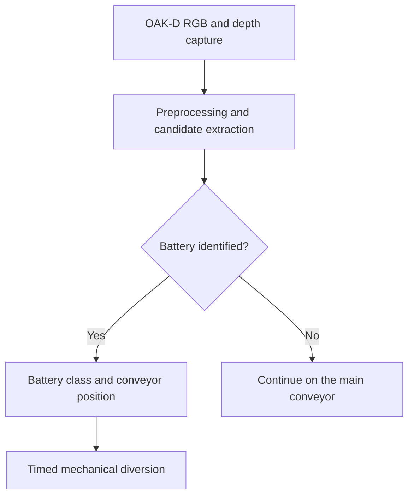

# BatteryNet

**Automated battery identification in mixed electronic waste**  
University of Sharjah | Computer Engineering | Senior Design Project

**Status: Ongoing development.** The workflow below describes the intended system. Implementation details, demonstrations, and measured results will be documented as individual stages are validated.

## Overview

BatteryNet explores the use of computer vision and RGB/depth sensing to identify visible batteries in mixed electronic waste and support conveyor-based sorting. The project combines perception, embedded computing, and a mechanical diversion system.

The intended application is to flag battery items for diversion and subsequent manual inspection or battery removal, helping address battery-related risks in e-waste handling.

## Project objectives

- Identify visible battery items among mixed e-waste objects.
- Distinguish target battery categories: AAA, pouch, and battery pack, with non-battery examples included during model development and evaluation.
- Estimate an identified object's position on the conveyor.
- Coordinate detection and conveyor motion with a sorting actuator.
- Evaluate perception performance and system timing through documented experiments.

## Intended system workflow

Flagged objects are intended to be routed to a separate handling path for manual inspection or removal. This diagram represents the design goal; a complete end-to-end demonstration will be documented after integration and testing.

## Hardware in the project design

| Component | Intended role |
| --- | --- |
| OAK-D Lite camera | Capture RGB images and depth information |
| NVIDIA Jetson Orin Nano | Run the perception pipeline and integration software |
| Conveyor | Transport mixed e-waste through the working area |
| 12 V linear actuator and diversion mechanism | Redirect flagged items |

## Perception approach

The planned pipeline uses RGB imagery and depth information for working-area preprocessing, candidate extraction, battery recognition, and object-position estimation. Segmentation and combinations of visual appearance with geometry/depth features are being investigated.

Model configurations, training procedures, dependencies, and evaluation methods will be documented with their corresponding source code and experiments.

## Scope and validation

The intended visual recognition scope is batteries visible to the camera. Validation will cover recognition errors, camera/depth calibration, processing time, and the timing between object detection and mechanical diversion.

Measured results will be reported with the evaluation conditions and example outputs so that the project's capabilities and limitations can be assessed.

## Project team

- Mir Umer Jarwar
- Anugrah Shaju
- Ahmed Faizan

University of Sharjah — Computer Engineering Senior Design Project.
